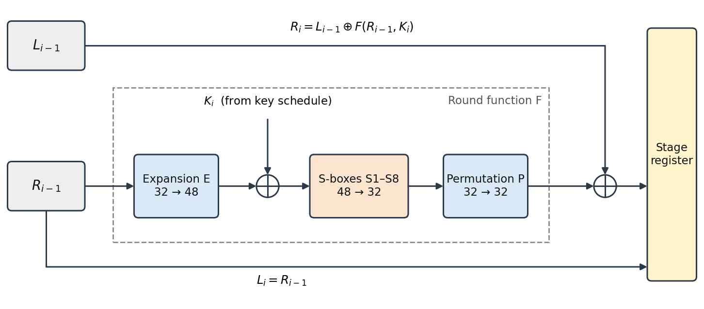
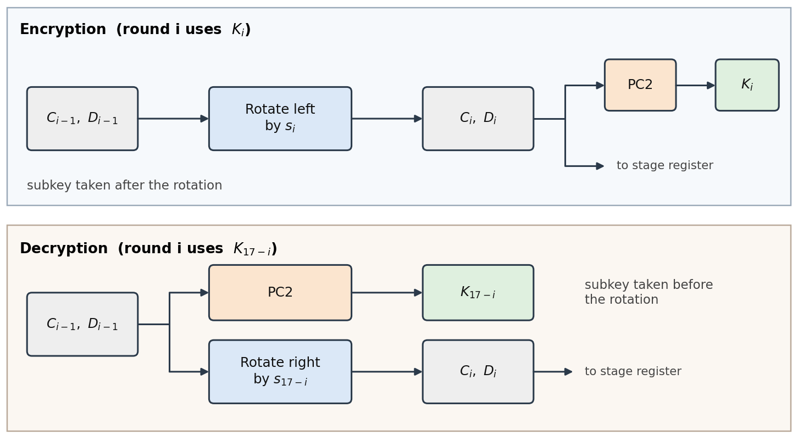
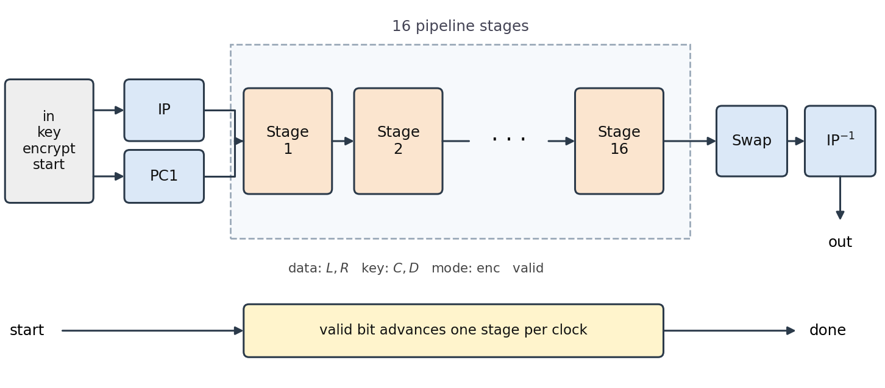
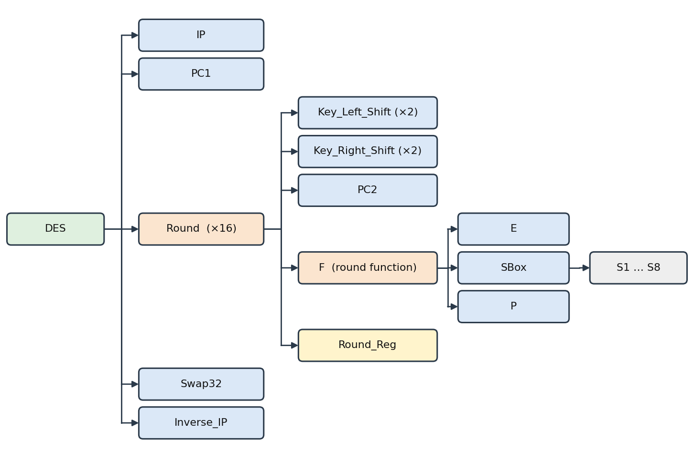

# 16-Stage Pipelined DES Core

Fully pipelined Verilog implementation of DES (64-bit block, 56-bit key) with per-block encrypt/decrypt selection, verified against a C reference model through DPI-C.

## Features

- 16 Feistel rounds unrolled into 16 pipeline stages
- Throughput: 1 block per clock cycle; latency: 16 clock cycles
- Encrypt/decrypt selectable per block (`encrypt` input); both modes can be interleaved without flushing
- Round keys generated on the fly in each stage (no key storage)
- Asynchronous active-low reset

## Layout

```
DES-Verilog/
├── rtl/                 Verilog RTL
├── tb/tb_des_c.v        Self-checking testbench (DPI-C)
├── tb/des.c            C reference model
├── sim/run_c.do         QuestaSim run script
└── docs/                Datapath, pipeline, and hierarchy diagrams
```

## Interface

| Signal | Dir | Width | Description |
|---|---|---|---|
| `clk` | in | 1 | Clock, rising-edge triggered |
| `rst_n` | in | 1 | Asynchronous active-low reset |
| `start` | in | 1 | Input valid; `in`, `key`, `encrypt` are sampled when high |
| `in` | in | `[1:64]` | Plaintext (encrypt) or ciphertext (decrypt) block |
| `key` | in | `[1:64]` | 64-bit key; parity bits 8, 16, …, 64 are ignored |
| `encrypt` | in | 1 | 1 = encrypt, 0 = decrypt |
| `done` | out | 1 | Output valid; one pulse per block, 16 cycles after `start` |
| `out` | out | `[1:64]` | Result block, valid when `done` is high |

All vectors use the standard DES MSB-first numbering (`[1:N]`).

## Operation

**Round (stage *i*):**

```
L_i = R_(i-1)
R_i = L_(i-1) XOR F(R_(i-1), K_i)
F   = P( SBox( E(R) XOR K ) )
```

After round 16 the halves are swapped, then the final permutation (`Inverse_IP`) gives `out`.

**Subkeys:** the key goes through `PC1` into 28-bit halves C₀, D₀. The left-rotation amount `s_i` is 1 for rounds 1, 2, 9, 16 and 2 otherwise (total 28, so C₁₆ = C₀).

| Mode | Subkey of stage *i* | Next C/D |
|---|---|---|
| Encrypt | `K_i = PC2(RotL(C,D, s_i))`, taken **after** the rotation | rotated left by `s_i` |
| Decrypt | `K_(17-i) = PC2(C,D)`, taken **before** the rotation | rotated right by `s_(17-i)` (1 bit in stages 1, 8, 15, 16; 2 bits otherwise) |

Decryption starts from K₁₆ = PC2(C₀, D₀) with no rotation, then walks the schedule backwards. The mode bit travels with its block, so each stage follows the mode of the block it holds.




**Pipeline behavior**

- `in`, `key`, `encrypt` are sampled on the clock edge where `start` is high and ignored otherwise.
- `start` is the valid bit of stage 1; it advances one stage per clock and appears at `done` after 16 cycles.
- Stage registers load only when their valid bit is high, otherwise they hold.
- `out` is combinational from the last stage and keeps its value until the next valid block.
- Reset clears all stage registers and `done`; `out` reads 0.

## Structure



```
DES
├── IP
├── PC1
├── Round (x16)
│   ├── Key_Left_Shift (x2)
│   ├── Key_Right_Shift (x2)
│   ├── PC2
│   ├── F                    (Round_Function.v)
│   │   ├── E
│   │   ├── SBox
│   │   │   └── S1 … S8
│   │   └── P
│   └── Round_Reg
├── Swap32                   (Swap.v)
└── Inverse_IP
```

### Module levels

| Level | Module | Inst. | Function |
|---|---|---|---|
| 0 | `DES` | 1 | Top level: IP/PC1, 16 stages, swap, final permutation |
| 1 | `IP` / `Inverse_IP` | 1 each | Initial / final 64-bit permutation |
| 1 | `PC1` | 1 | Key permutation, outputs C₀ and D₀ |
| 1 | `Round` | 16 | One pipeline stage: key-schedule step, round function, stage register |
| 1 | `Swap32` | 1 | Exchanges the halves after round 16 |
| 2 | `Key_Left_Shift` | 2 per round | Rotate a 28-bit half left by 1 or 2 (encrypt) |
| 2 | `Key_Right_Shift` | 2 per round | Rotate a 28-bit half right by 1 or 2 (decrypt) |
| 2 | `PC2` | 1 per round | 56 → 48-bit subkey |
| 2 | `F` | 1 per round | Round function |
| 2 | `Round_Reg` | 1 per round | Holds L, R, C, D, mode and valid; async reset |
| 3 | `E` | 1 per round | Expansion 32 → 48 |
| 3 | `SBox` | 1 per round | Eight 6 → 4 substitution tables |
| 3 | `P` | 1 per round | 32-bit permutation |
| 4 | `S1` … `S8` | 1 each per round | Lookup tables inside `SBox` |



## Verification

**Testbench:** `tb_des` (`tb/tb_des_c.v`), self-checking, QuestaSim.

- **Scoreboard**
  - *Reference model:* `tb/des.c`, called through DPI-C as `des_ref_c(data, key, enc)` when each operation is sent.
  - *Expected-result pipeline:* 16-deep shift register of expected results and valid bits, advancing with the DUT.
  - *Checker:* on every falling clock edge, `done` must equal the last-stage valid bit, and `out` must equal the expected value when valid.
- **Stimulus:** `send` issues one operation; `gap(n)` idles n cycles with `start` low while `in`, `key`, `encrypt` toggle randomly (inputs must be ignored).
- **Pass criterion:** zero mismatches, reported as `ALL TESTS PASSED (N results checked vs C)`.

### Test plan

| ID | Test case | Description | Ops |
|---|---|---|---|
| D1 | Special patterns × special keys | 8 data patterns × 8 keys, encrypt and decrypt | 128 |
| D2 | Walking-1 plaintext | One-hot plaintext, key `133457799BBCDFF1`, encrypt | 64 |
| D3 | Walking-1 key | One-hot key over all 64 bit positions, encrypt and decrypt | 128 |
| D4 | Weak and semi-weak keys | 4 weak + 2 semi-weak keys, encrypt and decrypt | 12 |
| D5 | Start-spacing sweep | Encrypt and decrypt separated by 0–18 idle cycles | 38 |
| D6 | Async reset with ops in flight | Reset between clock edges while the pipeline is busy, then recovery check | 20 |
| R1 | Random back-to-back | Random data, key and mode, no idle cycles | 500 |
| R2 | Random with gaps | Random data, key and mode, random 0–5 idle cycles | 500 |

## Running

Requires QuestaSim and `gcc`. From `sim/` in the Questa transcript:

```
do run_c.do
```

The script builds `../tb/des.c` as a DPI shared library (`-DDES_NO_MAIN`), compiles `../rtl/*.v` plus `../tb/tb_des_c.v`, loads the library with `-sv_lib` and runs the simulation.

## Files

| Path | Content |
|---|---|
| `rtl/DES.v`, `rtl/Round.v`, `rtl/Round_Reg.v`, `rtl/Round_Function.v`, `rtl/Swap.v` | Top level, pipeline stage, stage register, round function, half swap |
| `rtl/IP.v`, `rtl/Inverse_IP.v`, `rtl/PC1.v`, `rtl/PC2.v`, `rtl/E.v`, `rtl/P.v` | Permutation and expansion tables |
| `rtl/Key_Left_Shift.v`, `rtl/Key_Right_Shift.v` | Key-schedule rotations |
| `rtl/SBox.v`, `rtl/S1.v` … `rtl/S8.v` | Substitution boxes |
| `tb/des.c` | C reference model |
| `tb/tb_des_c.v`, `sim/run_c.do` | Testbench and Questa run script |
| `docs/*.png` | Datapath, subkey, pipeline, and hierarchy figures |
